  

  <b>Formado em Engenharia Informática e Multimédia</b> · Especializado em desenvolvimento <b>web e mobile</b> 
  Mentor de programação · CEO da <b>B-Software House</b>

  
  
  

---

### 🚀 Sobre mim

- 🎓 Formado em **Engenharia Informática e Multimédia** pelo Instituto Superior Universitário Nimi ya Lukeni, **especializado em desenvolvimento web e mobile**
- 🏢 Fundador da **[B-Software House](https://bsoftwarehouse.pages.dev/)**, uma agência que ajuda empresas a automatizar processos com software e IA
- 👨‍🏫 Mentor de programação
- 📚 Criador da **Biblioteca Inspunyl**, o sistema de gestão bibliotecária do meu trabalho de fim de curso
- 🌱 A aprender: novos conceitos, arquitecturas e ferramentas de IA
- 🎯 Objectivos: fazer mestrado e contribuir para o desenvolvimento de Angola 

### 🛠️ Stack

**Web**

  

**Mobile** · Flutter · React Native · Kotlin

  

**Backend e dados**

  

**Bases de dados em nuvem**

  

  
  
  
  

### 📦 Projectos em destaque

| Projecto | Descrição |
|---|---|
| 🤖 **Friday AI** | Assistente virtual com comandos de voz e automação de tarefas, ao estilo do Jarvis |
| 📚 **Biblioteca Inspunyl** | Sistema de gestão bibliotecária para o INSPUNYL |
| 🎰 **Lotos-AI** | Plataforma de análise de sorteios |
| 🛒 **XChange** | Mini bazar online do Soyo |
| 🌐 **Portfólios e plataformas web** | Sites e sistemas para clientes da B-Software House |

#### 🤖 Friday AI

Uma **assistente virtual inteligente**, inspirada no Jarvis, que obedece a comandos de voz e trabalha por mim.

- 🎙️ **Comandos de voz:** falo e ela executa
- ⚙️ **Automação de tarefas:** realiza as tarefas que lhe peço
- 📥 **Downloads:** descarrega ficheiros a pedido
- 🎵 **Música:** toca as músicas que eu quiser
- 💻 **Ajuda com programas:** auxilia no uso de aplicações e no desenvolvimento
- 🔎 **Pesquisas:** procura e resume informação
- ➕ E muito mais, a evoluir a cada versão

### 📊 Estatísticas

  

  

### 🤝 Vamos conversar?

Tens uma ideia ou um processo para automatizar? Fala comigo: **contactobsh45@gmail.com**
